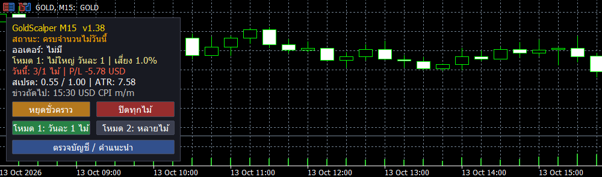

# GoldScalperM15

   -d4af37)  

**MetaTrader 5 Expert Advisor for XAUUSD (Gold) — M15 intraday Asian-range breakout**

**Current version: v1.38** · [What changed in each version (CHANGELOG)](CHANGELOG.md)


*On-chart panel (Thai UI): status, open trade, trade mode, today's trades and P/L, spread/ATR, next news event, and the Pause / Close all / Mode 1 / Mode 2 / Account check buttons.*
with a volatility filter, per-trade risk guard, news filter, on-chart control panel and mobile push notifications.

> ⚠️ **Disclaimer — for education and research only.** This project is **not investment advice** and **not an invitation, recommendation or solicitation to invest** or to trade any financial product. It is shared as a learning resource on how an EA can be built and tested. Trading gold and other leveraged products carries a high risk of loss. Backtest results do not guarantee future performance. Always test on a demo account first. You are solely responsible for how you use it and for your trading results. Full text: [DISCLAIMER.md](DISCLAIMER.md).

---

## 📊 Backtest results (XM Global `GOLD`, fixed 0.01 lot — see the next section for 1% risk sizing at every balance)

| Period | Data | Deposit | Net profit | Profit factor | Max equity DD | Trades |
|---|---|---|---|---|---|---|
| 2018 – 2026 | 1-minute OHLC | $3,000 | +$2,387 | **1.63** | **9.0%** | 503 |
| Oct 2024 – Oct 2026 | **real ticks (99%)** | $3,000 | +$1,693 | **1.61** | **10.2%** | 255 |

Net profit by year (2018–2026, $3,000): 2018: no trades · 2019: +49 · 2020: +178 · 2021: −20 · 2022: +151 · 2023: +22 · 2024: +60 · 2025: +390 · 2026: +1,558

**How it was validated**
- Parameters were chosen on **2020–2023 only**, then checked on periods the optimizer never saw: **2024–2026** (forward) and **2018–2019**.
- Neighbouring settings (stop 3–6 × ATR, exit 18:00–22:00) are also profitable, so the result is not a single lucky parameter set.
- Confirmed on real tick data, including spreads.

**Honest caveats**
- Most of the profit comes from 2025–2026, when gold was unusually volatile. In quiet years the EA mostly sits out (by design) and earns little.
- Fixed 0.01 lot means risk per trade grows with gold's volatility; the largest single loss in 2026 was about $230.
- The news filter cannot run in the Strategy Tester, so it was not part of these results.

## 💰 Any balance from $10: Standard, Micro and Cent accounts

The default lot size is **1% risk per trade** (`InpLotMode`), so the EA adapts to the balance automatically. What decides whether a small balance works is the **account type**, because the smallest lot (0.01) on a Standard account already risks $15–$100+ per stop-loss:

| Balance | Use |
|---|---|
| under $1,000 | **Micro or Cent account** (lots 100× smaller) |
| $1,000+ | Standard, Micro or Cent |

On a Standard account below ~$1,000 the risk guard skips trades; the start-up **account check** (Experts tab, or a popup from the panel button) detects the account type (Standard / Micro / Cent) and tells you what balance or account you need.

| Micro / Cent balance | = Standard balance | Lot sizing | Net 2018–2026 | PF | Max DD |
|---|---|---|---|---|---|
| $10 | $1,000 | min lot (≈1–3% risk) | +203% | 1.52 | 18.0% |
| $20 | $2,000 | 1% risk | +120% | 1.47 | 14.8% |
| $50 | $5,000 | 1% risk | +108% | 1.43 | 16.1% |
| $100 | $10,000 | 1% risk | +116% | 1.43 | 16.5% |
| $100 | $10,000 | **0.5% risk (Safe preset)** | +41% | 1.40 | **8.2%** |
| $1,000 | $100,000 | 1% risk | +134% | 1.45 | 17.1% |

A Micro account is a Standard account scaled down 100× (contract 1 oz instead of 100 oz), and a Cent account counts the balance in US cents, so $10 on Micro/Cent behaves like $1,000 on Standard. That is how these 8.8-year tests were run (1-minute OHLC, XM GOLD). A direct real-tick test of $10 on a Micro contract (Aug–Oct 2026) gave +$1.79, PF 1.41, DD 12.2%.

## ✨ Strategy (default)

1. **Range:** record the high/low of the Asian session, 00:00–08:00 server time.
2. **Volatility filter:** trade only on days when daily ATR(14) ≥ 1.6% of price; breakouts fail in quiet markets.
3. **Entry:** the first M15 candle that closes above the range high (buy) or below the range low (sell). Two trade modes, switchable with the **Mode 1 / Mode 2** panel buttons (a window explains both before you confirm) or `InpTradeStyle`: mode 1 takes one trade per day, mode 2 takes every breakout that meets the rules at `InpMultiRiskPct` (0.5%) per trade. Results (2018–2026, $3,000, 1-min OHLC):

   | Style | Preset | Net | PF | Max DD | Trades |
   |---|---|---|---|---|---|
   | One bigger trade a day | Mode 1 / `Default` (1 trade, 1% risk) | +$3,150 | 1.46 | 16.3% | 504 |
   | Several smaller trades | Mode 2 / `Unlimited_0.5pct` (no limit, 0.5% risk) | +$2,212 | 1.46 | 10.5% | 589 |
   | One smaller trade a day | `Safe_0.5pct` (1 trade, 0.5% risk) | +$2,334 | 1.56 | 9.1% | 504 |

   Extra trades of the day come after a failed breakout and lose more often, so the lower drawdown of the multi-trade style comes from the smaller size, not from the extra trades.
4. **Stop:** 4 × ATR(14, M15). No take-profit, breakeven or trailing stop: winners run.
5. **Exit:** all positions are closed at **20:00 server time**, so no overnight swap. XM's gold swap was the main reason holding strategies failed in testing.
6. **Position size:** **risk-based by default (1%)** or fixed lot: Lot = Balance × Risk% ÷ SL points (`InpLotMode`, `InpRiskPct`). In tests at $3,000, 1% risk gave PF 1.66 / DD 10.8% and 2% risk PF 1.55 / DD 17.9% (real ticks, Oct 2024 – Oct 2026).
7. **Risk guard:** skip any trade whose stop would lose more than 5% of balance.
8. **Confidence score (0–4):** +1 each for trading with the D1 trend, with the H1 trend, ADX(H1) 20–30 and RSI ≥ 70 in the trade direction; entries need ≥ 1 (`InpMinConfidence`). Each condition separated winners from losers in both 2018–2023 and 2024–2026. Score-0 trades lost money in both periods. The filter improved 2018–2026 (PF 1.56 → 1.63) but cost some profit in the 2024–2026 rally.
9. **Loss diagnosis & journal:** every loss is tagged with reasons (failed breakout, against trend, gave back profit, …) in the phone alert and in a CSV journal; 20-minute cooldown after a loss.

Other selectable strategies (`InpStrategy`): EMA pullback (v1.x, not profitable in tests), Donchian breakout, RSI(2) pullback.

## 🖥️ Other features

| | |
|---|---|
| 🚦 **Filters** | Trading hours · max spread · trades per day · daily loss limit · Friday close · daily close |
| 📰 **News filter** | MT5 economic calendar — pauses entries around high-impact USD events (live trading only) |
| 🖥️ **Control panel** | Live status (incl. "low volatility"), position P/L, today's stats, spread/ATR, next news · **Pause** / **Close all** / **Mode 1 / Mode 2** buttons |
| 🧭 **Account check** | Start-up check in the Experts tab, or a popup from the panel button (TH/EN), that analyses balance, leverage, contract size and the money one stop-loss would cost, then recommends and lets you choose (keep, switch to 1% risk lots, pause, remove) |
| 📱 **Notifications** | MT5 mobile push on open/close, news windows, daily-loss stop, skipped trades (max once a day) |

## 🚀 Installation

**Windows (one click):** run `install_to_MT5.bat`. It compiles the EA, shows the target folder and — after you confirm with **Y** — copies it to `MQL5\Experts\MyEA` and the preset to `MQL5\Presets`.

**Manual:** copy `GoldScalperM15.mq5` into `MQL5\Experts` (*File → Open Data Folder*), open it in MetaEditor and press **F7**.

Attach the EA to a **GOLD/XAUUSD** chart, enable **Allow Algo Trading**. The defaults are the validated settings (`presets/GoldScalperM15_Default.set` is the same).

> Times are **broker server time**. The defaults were validated on XM Global (GMT+2/+3). Other brokers may need the hours adjusted.

📖 Full guide: [USER_GUIDE.md](USER_GUIDE.md) · Thai: [คู่มือ_GoldScalperM15.md](คู่มือ_GoldScalperM15.md) · What changed in each version: [CHANGELOG.md](CHANGELOG.md)

## 🧪 Reproducing the backtests

`tools/backtest.ps1` drives the MT5 Strategy Tester from PowerShell (compile, single backtests, grid/genetic optimization with a forward period, report parsing):

```powershell
. .\tools\backtest.ps1
Build-Dev
Invoke-Backtest -Name check -From 2024.10.13 -To 2026.10.12 -Model 4 -Deposit 3000
```

Paths at the top of the script point to the author's MT5 installation; adjust them for yours.

## 📁 Repository contents

```
GoldScalperM15.mq5          EA source code (MQL5)
install_to_MT5.bat          One-click compile + install helper (Windows)
presets/                    Validated default preset
tools/backtest.ps1          Backtest / optimization automation
USER_GUIDE.md               User guide (English)
CHANGELOG.md                What changed in each version
LICENSE                     MIT license
DISCLAIMER.md               Education-only / not investment advice (EN + TH)
docs/images/                Screenshots
คู่มือ_GoldScalperM15.md      User guide (Thai)
```

## 📄 License

[MIT](LICENSE) — free to use, modify and share, including commercially, as long as the copyright notice (credit to **Thapanapat Pumulna / Kla1524**) is kept. Provided as is, with no warranty. The [disclaimer](DISCLAIMER.md) applies to every use.

## 🗺️ Roadmap

- [ ] Telegram notifications & remote control
- [x] Trade journal export (CSV) — v1.32
- [ ] English / Thai language switch for the panel and alerts (popup already supports both)
